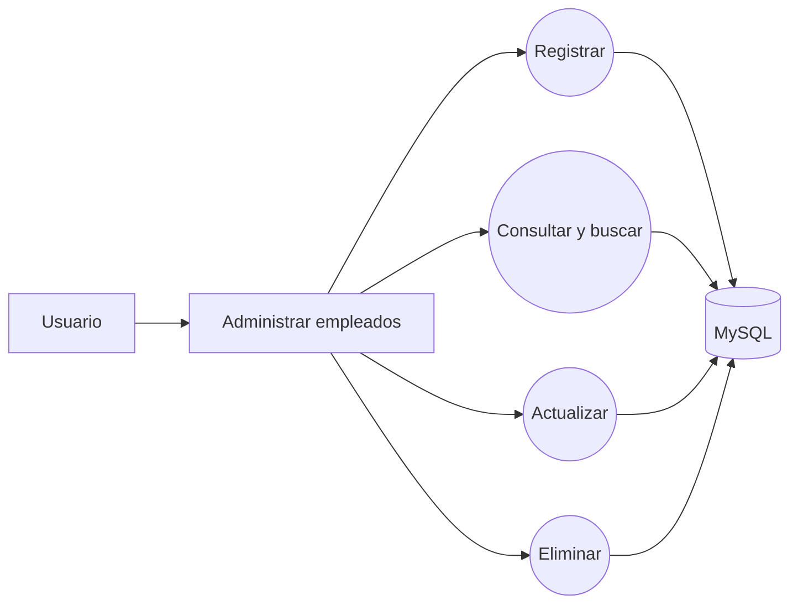
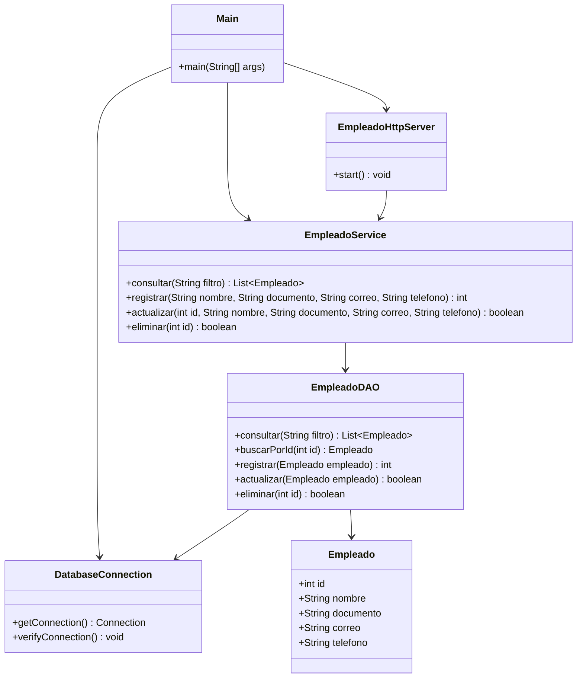

# Artefactos del modulo de empleados

Estos artefactos se elaboraron para este prototipo porque no se encontraron diagramas, historias ni disenos anteriores en la carpeta recibida. Deben compararse con los artefactos aprobados del proyecto, si existen, antes de presentar la entrega final.

## Historia de usuario

**HU-01 — Administrar empleados**

Como usuario del sistema, quiero registrar, consultar, actualizar y eliminar empleados para mantener su informacion organizada y actualizada en la base de datos.

### Criterios de aceptacion

1. El sistema permite registrar empleados con nombre, documento, correo y telefono obligatorios.
2. El sistema muestra los empleados guardados y permite filtrar por nombre, documento o correo.
3. El usuario puede editar los datos de un empleado existente.
4. El usuario debe marcar la confirmacion antes de enviar una eliminacion.
5. Si falta un dato obligatorio o no tiene formato valido, se informa el error y no se ejecuta la operacion.
6. Las operaciones persisten en MySQL mediante JDBC y consultas parametrizadas.

## Casos de uso

**Actor:** usuario del sistema.

| Caso | Accion del usuario | Resultado esperado |
|---|---|---|
| CU-01 Registrar empleado | Completa los campos y selecciona «Registrar empleado». | El empleado se guarda y aparece en la lista. |
| CU-02 Consultar empleados | Abre la pagina o ingresa un criterio de busqueda. | Se muestran todos los registros o los que coinciden. |
| CU-03 Actualizar empleado | Modifica los datos de una fila y selecciona «Guardar». | Los cambios se guardan y se informa el resultado. |
| CU-04 Eliminar empleado | Marca «Confirmar eliminacion» y selecciona «Eliminar». | El registro se elimina y se informa el resultado. |

### Diagrama de casos de uso

## Diagrama de clases

## Modelo de datos

La tabla `empleados` usa `id` como clave primaria autoincremental. `documento` y `correo` son unicos. `nombre`, `documento`, `correo` y `telefono` son obligatorios. El DDL ejecutable esta en [`../database/schema.sql`](../database/schema.sql).

## Tecnologias

Java 25, servidor HTTP incluido en el JDK, JDBC, MySQL Connector/J 26.7.0 y MariaDB 10.4.32 de XAMPP para las pruebas locales.
